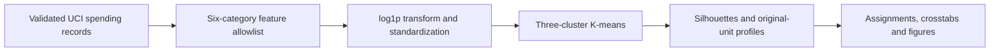
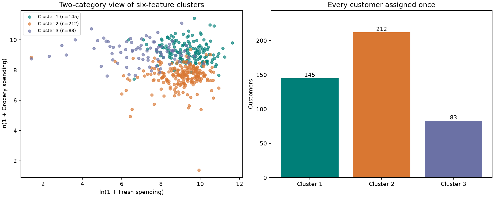
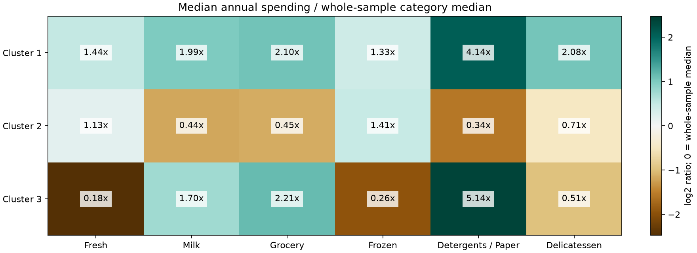

# Project 9: folder structure and copyable files

Files are already created. Each hand-authored file appears below in its own code block. The small public CSV is bundled separately and can be downloaded by main.py if absent. Running main.py recreates generated artifacts. No other project folder or model service is required.

```text
projects/09-wholesale-customer-segmentation/
  main.py
  test_segmentation.py
  requirements.txt
  .gitignore
  .gitattributes
  README.md
  PROJECT_FILES.md
  data/
    wholesale_customers.csv  (unmodified public source)
    SOURCE.md
  outputs/
    metrics.json
    data_audit.json
    customer_segments.csv
    cluster_summary.csv
    cluster_medians.csv
    cluster_means.csv
    median_ratios.csv
    channel_counts.csv
    channel_percentages.csv
    region_counts.csv
    region_percentages.csv
    transformed_features.csv
    standardized_log_centers.csv
    segmentation_overview.png
    cluster_profiles.png
    verification.md
```

## main.py

```python
"""Describe public wholesale customers using one fixed three-cluster model."""

from hashlib import sha256
from io import BytesIO
import json
from pathlib import Path
import time
from urllib.request import urlopen
from zipfile import ZipFile

import numpy as np
import pandas as pd
from sklearn.cluster import KMeans
from sklearn.metrics import silhouette_samples, silhouette_score
from sklearn.pipeline import Pipeline
from sklearn.preprocessing import FunctionTransformer, StandardScaler

ROOT = Path(__file__).resolve().parent
SOURCE_URL = "https://archive.ics.uci.edu/static/public/292/wholesale%2Bcustomers.zip"
SOURCE_SHA256 = "c3d018c643565b85cee733c4a2ac76dd76e080e857cb23f0ccfcc2e15a6c17ef"
FEATURES = ["Fresh", "Milk", "Grocery", "Frozen", "Detergents_Paper", "Delicassen"]
SEED = 42
N_CLUSTERS = 3


def validate_spending(data):
    missing = set(FEATURES) - set(data.columns)
    if missing:
        raise ValueError(f"Missing spending columns: {sorted(missing)}")
    values = data[FEATURES].to_numpy(dtype=float)
    if not np.isfinite(values).all() or (values < 0).any():
        raise ValueError("Spending must be finite, complete and nonnegative.")
    return data[FEATURES]


def load_data(path=None):
    path = Path(path) if path is not None else ROOT / "data" / "wholesale_customers.csv"
    if not path.exists():
        with urlopen(SOURCE_URL, timeout=30) as response:
            with ZipFile(BytesIO(response.read())) as archive:
                raw = archive.read("Wholesale customers data.csv")
        if sha256(raw).hexdigest() != SOURCE_SHA256:
            raise ValueError("Downloaded data differs from the audited source.")
        path.parent.mkdir(parents=True, exist_ok=True)
        path.write_bytes(raw)
    if sha256(path.read_bytes()).hexdigest() != SOURCE_SHA256:
        raise ValueError("Source checksum mismatch; restore the bundled UCI CSV.")
    data = pd.read_csv(path)
    if data.shape != (440, 8) or data.isna().any().any():
        raise ValueError("Expected 440 complete source rows and eight columns.")
    validate_spending(data)
    if not data["Channel"].isin([1, 2]).all() or not data["Region"].isin([1, 2, 3]).all():
        raise ValueError("Unknown channel or region codes.")
    audit = {"source_url": SOURCE_URL, "source_sha256": SOURCE_SHA256,
             "rows": len(data), "missing_values": int(data.isna().sum().sum()),
             "exact_duplicate_rows": int(data.duplicated().sum()),
             "feature_minima": data[FEATURES].min().astype(int).to_dict(),
             "feature_maxima": data[FEATURES].max().astype(int).to_dict(),
             "feature_medians": data[FEATURES].median().to_dict(),
             "channel_counts": data["Channel"].value_counts().sort_index().to_dict(),
             "region_counts": data["Region"].value_counts().sort_index().to_dict()}
    data.insert(0, "customer_id", [f"ROW-{i:03d}" for i in range(1, len(data) + 1)])
    # A display-only summary, NOT an extra clustering input.
    data["total_category_spending"] = data[FEATURES].sum(axis=1)
    return data, audit


def fit_segments(data):
    values = validate_spending(data)
    model = Pipeline([
        ("log", FunctionTransformer(np.log1p, feature_names_out="one-to-one")),
        ("scale", StandardScaler()),
        ("kmeans", KMeans(n_clusters=N_CLUSTERS, random_state=SEED, n_init=20, algorithm="lloyd")),
    ])
    model.fit(values)
    transformed = model[:-1].transform(values)
    raw_labels = model.named_steps["kmeans"].labels_
    customers = data.copy()
    # Labels are arbitrary identifiers, not an ordering from worse to better.
    customers["cluster"] = raw_labels + 1
    customers["silhouette"] = silhouette_samples(transformed, raw_labels, metric="euclidean")
    score = float(silhouette_score(transformed, raw_labels, metric="euclidean"))
    return model, customers, transformed, score


def profile_segments(customers):
    groups = customers.groupby("cluster")
    medians = groups[FEATURES].median()
    means = groups[FEATURES].mean()
    overall = customers[FEATURES].median()
    # Actual source medians are positive; zero reference values remain undefined.
    median_ratios = medians.divide(overall.replace(0, np.nan), axis="columns")
    summary = groups.agg(customers=("customer_id", "size"),
                         mean_total_spending=("total_category_spending", "mean"),
                         median_total_spending=("total_category_spending", "median"),
                         mean_silhouette=("silhouette", "mean"))
    summary["share_pct"] = 100 * summary["customers"] / len(customers)
    return summary, medians, means, median_ratios


def save_charts(customers, summary, ratios, output):
    import matplotlib
    matplotlib.use("Agg")
    import matplotlib.pyplot as plt

    colors = {1: "#007F78", 2: "#D97732", 3: "#6B71A5"}
    fig, axes = plt.subplots(1, 2, figsize=(12, 4.8), layout="constrained")
    for cluster, group in customers.groupby("cluster"):
        axes[0].scatter(np.log1p(group["Fresh"]), np.log1p(group["Grocery"]), color=colors[cluster],
                        alpha=0.65, s=22, label=f"Cluster {cluster} (n={len(group)})")
    axes[0].set(title="Two-category view of six-feature clusters", xlabel="ln(1 + Fresh spending)",
                ylabel="ln(1 + Grocery spending)")
    axes[0].legend(fontsize=8)
    bars = axes[1].bar([f"Cluster {i}" for i in summary.index], summary["customers"],
                       color=[colors[i] for i in summary.index])
    axes[1].bar_label(bars)
    axes[1].set(title="Every customer assigned once", ylabel="Customers")
    axes[1].set_ylim(0, summary["customers"].max() * 1.15)
    fig.savefig(output / "segmentation_overview.png", dpi=160)
    plt.close(fig)
    fig, axis = plt.subplots(figsize=(11, 4), layout="constrained")
    heat = np.log2(ratios.to_numpy())
    limit = max(1.0, float(np.nanmax(np.abs(heat))))
    image = axis.imshow(heat, cmap="BrBG", vmin=-limit, vmax=limit, aspect="auto")
    labels = ["Fresh", "Milk", "Grocery", "Frozen", "Detergents / Paper", "Delicatessen"]
    axis.set_xticks(range(6), labels)
    axis.set_yticks(range(len(ratios)), [f"Cluster {i}" for i in ratios.index])
    axis.set_title("Median annual spending / whole-sample category median")
    for row in range(len(ratios)):
        for col in range(6):
            axis.text(col, row, f"{ratios.iloc[row, col]:.2f}x", ha="center", va="center", fontsize=10,
                      bbox={"facecolor": "white", "alpha": 0.8, "edgecolor": "none"})
    fig.colorbar(image, ax=axis, label="log2 ratio; 0 = whole-sample median")
    fig.savefig(output / "cluster_profiles.png", dpi=160)
    plt.close(fig)


def main():
    start = time.perf_counter()
    output = ROOT / "outputs"
    output.mkdir(exist_ok=True)
    data, audit = load_data()
    model, customers, transformed, score = fit_segments(data)
    summary, medians, means, ratios = profile_segments(customers)
    customers.to_csv(output / "customer_segments.csv", index=False)
    summary.to_csv(output / "cluster_summary.csv")
    medians.to_csv(output / "cluster_medians.csv")
    means.to_csv(output / "cluster_means.csv")
    ratios.to_csv(output / "median_ratios.csv")
    for column in ["Channel", "Region"]:
        counts = pd.crosstab(customers["cluster"], customers[column])
        counts.to_csv(output / f"{column.lower()}_counts.csv")
        (100 * counts.divide(counts.sum(axis=1), axis=0)).to_csv(output / f"{column.lower()}_percentages.csv")
    pd.DataFrame(transformed, columns=FEATURES).assign(customer_id=data["customer_id"]).to_csv(
        output / "transformed_features.csv", index=False)
    pd.DataFrame(model.named_steps["kmeans"].cluster_centers_, columns=FEATURES,
                 index=pd.Index([1, 2, 3], name="cluster")).to_csv(output / "standardized_log_centers.csv")
    (output / "data_audit.json").write_text(json.dumps(audit, indent=2) + "\n", encoding="utf-8")
    save_charts(customers, summary, ratios, output)
    metrics = {"customers": len(customers), "features": FEATURES, "n_clusters": N_CLUSTERS,
               "random_state": SEED, "n_init": 20, "silhouette_score": score,
               "inertia_standardized_log_space": float(model.named_steps["kmeans"].inertia_),
               "iterations": int(model.named_steps["kmeans"].n_iter_),
               "cluster_sizes": {str(key): int(value) for key, value in summary["customers"].items()},
               "negative_silhouette_customers": int((customers["silhouette"] < 0).sum()),
               "evaluation": "Internal full-cohort geometry in six standardized log-spending features, not predictive accuracy or held-out validation.",
               "note": "Three clusters fixed in advance. Levels and patterns, not pure proportional mix; labels are arbitrary.",
               "run_seconds": round(time.perf_counter() - start, 3)}
    (output / "metrics.json").write_text(json.dumps(metrics, indent=2) + "\n", encoding="utf-8")
    print(summary.round(3).to_string())
    print("\nMedian category spending (original monetary units):\n", medians.to_string())
    print(f"\nSilhouette (internal, full cohort): {score:.6f}")
    print("Negative silhouette customers:", metrics["negative_silhouette_customers"])


if __name__ == "__main__":
    main()
```

## test_segmentation.py

```python
"""Checks the feature boundary, reproducibility, profiles and silhouette arithmetic."""
from pathlib import Path
import tempfile
import unittest

import numpy as np
from sklearn.metrics import pairwise_distances

from main import FEATURES, fit_segments, load_data, profile_segments, validate_spending


class SegmentationChecks(unittest.TestCase):
    def test_source_integrity(self):
        data, audit = load_data()
        self.assertEqual(len(data), 440)
        self.assertEqual(audit["missing_values"], 0)
        self.assertEqual(audit["exact_duplicate_rows"], 0)
        self.assertTrue(data["customer_id"].is_unique)
        with tempfile.TemporaryDirectory() as folder:
            path = Path(folder) / "changed.csv"
            path.write_text("modified", encoding="utf-8")
            with self.assertRaisesRegex(ValueError, "checksum"):
                load_data(path)

    def test_invalid_spending_is_rejected(self):
        data, _ = load_data()
        for invalid in [-1, np.nan, np.inf]:
            changed = data.copy()
            changed["Fresh"] = changed["Fresh"].astype(float)
            changed.loc[0, "Fresh"] = invalid
            with self.assertRaises(ValueError):
                validate_spending(changed)

    def test_reproducible_full_assignment_and_preprocessing(self):
        data, _ = load_data()
        first, assigned, transformed, score = fit_segments(data)
        _, second, _, second_score = fit_segments(data)
        np.testing.assert_array_equal(assigned["cluster"], second["cluster"])
        self.assertAlmostEqual(score, second_score)
        np.testing.assert_allclose(transformed.mean(axis=0), 0, atol=1e-12)
        self.assertEqual(first.named_steps["kmeans"].n_features_in_, 6)
        self.assertEqual(set(assigned["cluster"]), {1, 2, 3})
        self.assertEqual(len(assigned), len(data))

    def test_metadata_does_not_influence_clusters(self):
        data, _ = load_data()
        _, original, _, _ = fit_segments(data)
        changed = data.copy()
        changed["Channel"] = 3 - changed["Channel"]
        changed["Region"] = 999
        changed["total_category_spending"] = 0
        _, other, _, _ = fit_segments(changed)
        np.testing.assert_array_equal(original["cluster"], other["cluster"])

    def test_profiles_reconcile_and_use_original_units(self):
        data, _ = load_data()
        _, customers, _, _ = fit_segments(data)
        summary, medians, _, ratios = profile_segments(customers)
        self.assertEqual(summary["customers"].sum(), 440)
        self.assertAlmostEqual(summary["share_pct"].sum(), 100)
        for cluster in summary.index:
            group = customers[customers["cluster"] == cluster]
            np.testing.assert_allclose(medians.loc[cluster], group[FEATURES].median())
            np.testing.assert_allclose(ratios.loc[cluster], medians.loc[cluster] / data[FEATURES].median())

    def test_silhouette_matches_independent_distance_formula(self):
        data, _ = load_data()
        _, customers, transformed, score = fit_segments(data)
        distances = pairwise_distances(transformed)
        labels = customers["cluster"].to_numpy()
        calculated = []
        for i in range(len(labels)):
            own = np.flatnonzero(labels == labels[i])
            own = own[own != i]
            a = distances[i, own].mean()
            b = min(distances[i, labels == label].mean() for label in np.unique(labels) if label != labels[i])
            calculated.append((b - a) / max(a, b))
        np.testing.assert_allclose(calculated, customers["silhouette"], atol=1e-10)
        self.assertAlmostEqual(np.mean(calculated), score)


if __name__ == "__main__":
    unittest.main()
```

## requirements.txt

```text
numpy==2.5.4
pandas==3.1.0
scikit-learn==1.9.1
matplotlib==3.11.2
```

## .gitignore

```text
.venv/
__pycache__/
*.py[cod]
.pytest_cache/
.env
.env.*
!.env.example
*.log
```

## .gitattributes

```text
# Keep the audited source bytes unchanged across operating systems.
data/wholesale_customers.csv -text
```

## data/SOURCE.md

````markdown
# Source, attribution and transformations

- **Dataset:** Wholesale customers, UCI dataset 292.
- **Source page:** https://archive.ics.uci.edu/dataset/292/wholesale+customers
- **Direct no-login download:** https://archive.ics.uci.edu/static/public/292/wholesale%2Bcustomers.zip
- **Attribution:** Cardoso, M. (2013). Wholesale customers [Dataset]. UCI Machine Learning Repository. https://doi.org/10.24432/C5030X
- **License:** CC BY 4.0, https://creativecommons.org/licenses/by/4.0/
- **Original archive member:** Wholesale customers data.csv. Saved locally as wholesale_customers.csv with unchanged bytes.
- **SHA-256:** `c3d018c643565b85cee733c4a2ac76dd76e080e857cb23f0ccfcc2e15a6c17ef`.

The source describes 440 wholesale distributor customers with annual category spending in unspecified monetary units. It provides six spending fields plus channel and region codes. Exact observation dates, order frequency, product quantities, prices, costs and profit are unavailable.

Channel codes: 1=Horeca (hotel/restaurant/cafe), 2=retail. Region codes: 1=Lisbon, 2=Oporto, 3=Other. These fields are retained for descriptive profiles only and excluded from clustering.

The original has no missing values or exact duplicate rows; all six spending columns are positive in this version. No rows are removed or imputed. The raw spelling `Delicassen` is preserved; charts display the category as Delicatessen.

The project adds a one-based row ID (`ROW-001` to `ROW-440`), total recorded category spending for reporting, cluster labels and silhouette diagnostics. Row IDs are not source account identifiers. Clustering applies log1p and standard scaling to the six raw category amounts only, so both spending magnitude and category pattern affect distance. It is not a pure proportional-mix analysis.

This is an exploratory fit to the whole cohort. No target labels, customer purchases, dates or synthetic observations are invented, and no held-out or future-customer performance is claimed.
````

## README.md

````markdown
# Wholesale Customer Segmentation

A descriptive six-feature customer segmentation pipeline using log-transformed annual spending, cohort standardization and fixed three-cluster K-means, with original-unit profiles and per-customer diagnostics.

> Evaluation boundary: the full cohort fits the preprocessing and clustering model. Silhouette measures internal geometry, not predictive accuracy, ground-truth customer classes or business impact.

## Contents

- [Overview](#overview)
- [Dataset and data contract](#dataset-and-data-contract)
- [Architecture and components](#architecture-and-components)
- [Processing pipeline](#processing-pipeline)
- [Configuration and metric definitions](#configuration-and-metric-definitions)
- [Recorded results and evidence](#recorded-results-and-evidence)
- [Interpretation and operational use](#interpretation-and-operational-use)
- [Running locally](#running-locally)
- [Validation and reproducibility](#validation-and-reproducibility)
- [Project structure](#project-structure)
- [Technology stack](#technology-stack)
- [Limitations and next steps](#limitations-and-next-steps)
- [Further technical documentation](#further-technical-documentation)

## Overview

Which customers have similar spending patterns, and how could those profiles inform account-planning conversations?

## Dataset and data contract

- Public source: [UCI Wholesale customers](https://archive.ics.uci.edu/dataset/292/wholesale+customers), **440 rows and eight original columns**.
- Attribution: Cardoso, M. (2013). Wholesale customers [Dataset]. UCI Machine Learning Repository. [DOI: 10.24432/C5030X](https://doi.org/10.24432/C5030X). License: [CC BY 4.0](https://creativecommons.org/licenses/by/4.0/).
- The unchanged [original CSV](data/wholesale_customers.csv) is bundled for offline use; [data/SOURCE.md](data/SOURCE.md) records its source and checksum.
- There are **no missing values or exact duplicate rows** in the audited version. No rows were removed, imputed or generated synthetically.

| Field | Meaning / use |
|---|---|
| Fresh | Annual fresh-product spending; clustering input |
| Milk | Annual milk spending; clustering input |
| Grocery | Annual grocery spending; clustering input |
| Frozen | Annual frozen-product spending; clustering input |
| Detergents_Paper | Annual detergents/paper spending; clustering input |
| Delicassen | Annual delicatessen spending, keeping the raw source spelling; clustering input |
| Channel | 1=Horeca, 2=retail; descriptive context only |
| Region | 1=Lisbon, 2=Oporto, 3=Other; descriptive context only |
| customer_id | Added row reference such as ROW-001; not a real account ID |
| total_category_spending | Reporting sum of the six recorded categories; excluded from model inputs |

Spending uses **unspecified monetary units (m.u.)**, not an assumed currency or unit quantity. There are no transaction dates, order counts, product prices, margins or inventory levels. Annual category spending cannot establish purchase frequency, seasonal demand or supplier reliability.

## Architecture and components



| Component | Entry points or assets | Responsibility |
|---|---|---|
| [main.py](main.py) | validate_spending / load_data | Verify source identity, nonnegative finite spending and valid context codes. |
| [main.py](main.py) | fit_segments | Fit log1p, StandardScaler and one fixed K-means configuration to all 440 rows. |
| [main.py](main.py) | profile_segments | Summarize original-unit means/medians and post-fit channel/region context. |
| [main.py](main.py) | save_charts | Display a two-feature projection and category-median ratios. |
| [test_segmentation.py](test_segmentation.py) | Automated checks | Confirm metadata exclusion, repeatability, profile reconciliations and an independent silhouette calculation. |

## Processing pipeline

1. Verify source bytes, expected shape, finite/nonnegative category values and channel/region codes. Add traceable row IDs.
2. Use only the six spending columns. Exclude channel, region, row IDs and derived total spending from the model.
3. Apply `log1p(x)` to reduce the influence of large spending values while retaining every customer. Then standardize each transformed category to zero mean/unit variance within this cohort.
4. Fit one [K-means model](https://scikit-learn.org/stable/modules/generated/sklearn.cluster.KMeans.html) with **three clusters**, `random_state=42`, `n_init=20` and the Lloyd algorithm. The cluster count was fixed in advance; no search for an optimal count was performed.
5. Compute the full-cohort Euclidean silhouette score in the **six-dimensional standardized log space**, plus each customer's silhouette diagnostic.
6. Summarize counts, original-unit category medians/means and total spending. Add channel/region crosstabs after assignment, and plot a two-category view and median profiles.
7. Export all assignments, transformed features, profiles, centers, diagnostics and source audit.

This model captures **both spending levels and category patterns**. It does not normalize each customer's amounts into budget proportions. The whole cohort fits the transform and model because this is descriptive segmentation; there is no supervised target or train/test accuracy estimate.

## Configuration and metric definitions

| Setting or measure | Definition |
|---|---|
| Model inputs | Fresh, Milk, Grocery, Frozen, Detergents_Paper, Delicassen |
| Representation | `log1p(spending)` followed by per-feature standardization |
| K-means | `n_clusters=3`, `random_state=42`, `n_init=20`, `algorithm="lloyd"` |
| Silhouette | `(b - a) / max(a, b)` using distances in the six-dimensional transformed space |
| Inertia | Sum of squared distances to assigned centers in transformed space |
| Total-spending median | Median of each customer's summed raw spending; not the sum of category medians |
| Profile ratio | Cluster raw-category median divided by the cohort raw-category median |

Channel, Region, added row identifiers and derived total spending are excluded from fitting. The transform preserves spending scale as well as category pattern; it is not a proportional-budget representation. Cluster numbers are arbitrary, and the two-axis scatter is not a complete view of six-dimensional assignments.

## Recorded results and evidence

These results were computed by running the project with the pinned environment and seed 42.

| Measured item | Result |
|---|---:|
| Customers assigned | 440 / 440 |
| Clusters | 3 |
| Full-cohort silhouette | **0.258278** |
| Customers with negative silhouettes | **22** |
| Within-cluster inertia, standardized log space | 1,553.412722 |

Silhouette ranges from -1 to 1; higher indicates stronger separation under the chosen distance representation. **0.2583 suggests limited separation and overlapping groups**. The 22 negative silhouettes identify records with weaker assignments under this diagnostic, not automatically invalid customers. This score is internal geometry, not predictive accuracy or proof that the segments are commercially useful. Inertia is in transformed-space squared-distance units, not monetary units.

| Cluster | Customers | Cohort share | Median total recorded category spending | Descriptive profile |
|---|---:|---:|---:|---|
| 1 | 145 | 32.95% | 46,100 m.u. | Broader higher spending: every category median exceeds the whole-sample category median |
| 2 | 212 | 48.18% | 18,498 m.u. | Fresh/frozen emphasis with lower total spending |
| 3 | 83 | 18.86% | 27,251 m.u. | Milk/grocery/detergents emphasis, with lower fresh/frozen spending |

Rounded shares may not sum to exactly 100%; exact counts reconcile to 440. Total spending is summed per customer before taking its median. Summing separate category medians would give a different statistic. Cluster numbers are arbitrary identifiers, not rankings or ground-truth classes.



The scatter displays Fresh and Grocery only, with logarithmic axes expressed as `ln(1 + spending)`. The model uses all six standardized log features; this two-category view does not show every dimension used to assign customers.



Each profile cell is a cluster's raw category median divided by that category's whole-sample median. A value of 2x means twice the reference median, not twice the order frequency or profit. Colors use log2 of that ratio for visibility. These display ratios are not additional clustering features or customer-level budget proportions.

Examples behind the descriptions: cluster 1 has median Fresh spending **12,205** and Grocery **9,965**; cluster 2 has Fresh **9,635** and Frozen **2,151**, with Milk **1,598.5**; cluster 3 has Grocery **10,487** and Detergents/Paper **4,196**, with Fresh **1,531**. All values are m.u.

For external context, cluster 2 contains **209 Horeca and three retail customers**. That is a post-fit association from the excluded Channel field, not a classification result or a reason to rename every customer in that group as a particular business type.

Evidence: [metrics](outputs/metrics.json), [customer assignments and silhouettes](outputs/customer_segments.csv), [cluster summary](outputs/cluster_summary.csv), [category medians](outputs/cluster_medians.csv), [category means](outputs/cluster_means.csv), [median ratios](outputs/median_ratios.csv), [channel counts](outputs/channel_counts.csv), [channel percentages](outputs/channel_percentages.csv), [region counts](outputs/region_counts.csv), [region percentages](outputs/region_percentages.csv), [transformed features](outputs/transformed_features.csv), [standardized log centers](outputs/standardized_log_centers.csv), [data audit](outputs/data_audit.json) and [verification record](outputs/verification.md).

## Interpretation and operational use

- **Cluster 1: discuss broad-category requirements.** Its 145 customers have above-reference medians across all six categories and the highest median recorded total, 46,100 m.u. Use the profile to structure account conversations; higher spending alone does not establish higher profitability or service priority.
- **Cluster 2: explore fresh/frozen assortment needs.** Among 212 customers, Fresh/Frozen medians exceed their whole-sample reference medians while several other categories are lower. Its 209 Horeca records offer useful context, but annual spending alone cannot determine delivery cadence, cold-storage capacity or seasonal demand.
- **Cluster 3: explore grocery and household-category needs.** Its 83 customers show Grocery and Detergents/Paper medians of 10,487 and 4,196 m.u. Review individual accounts and weak silhouette assignments before applying a segment-wide action. No cross-selling, retention gain or operational savings was measured.

## Running locally

Prerequisite: **Python 3.12+** and a terminal; verified with Python 3.12. No paid API, cloud account, GPU, database server, model runtime or other project folder is needed. From the repository root, run these three commands in your Python environment:

```powershell
cd projects/09-wholesale-customer-segmentation
python -m pip install -r requirements.txt
python main.py
```

The source CSV is bundled. If it is absent, the script downloads the small official archive and verifies the source checksum. Changed input fails explicitly. `.gitattributes` prevents Git newline conversion from changing the original bytes on another laptop.

Optional verification, separate from launching: `python -m unittest -v`. Re-running the script rebuilds outputs without adding customers. There is no web dashboard or stored model binary required for this small analysis.

## Validation and reproducibility

The automated suite contains **6 tests**. It checks the following implementation boundaries:

Test implementation: [test_segmentation.py](test_segmentation.py).

- Source integrity.
- Invalid spending is rejected.
- Reproducible full assignment and preprocessing.
- Metadata does not influence clusters.
- Profiles reconcile and use original units.
- Silhouette matches independent distance formula.

From the project directory, run:

```powershell
python -m unittest -v
```

Recorded execution and any browser-review evidence is retained in [outputs/verification.md](outputs/verification.md). Reported figures correspond to saved execution artifacts; running a report generator can overwrite its generated outputs. Package requirements, source checksums and fixed parameters define the reproducibility boundary; elapsed times and some model/solver outputs can vary across environments.

## Project structure

```text
09-wholesale-customer-segmentation/
  main.py
  PROJECT_FILES.md
  README.md
  requirements.txt
  test_segmentation.py
  data/
    Bundled inputs, provenance and prepared data
  outputs/
    Recorded metrics, audit files, tables and figures
```

Generated environments, database files, model artifacts and compiled assets follow the project's [.gitignore](.gitignore). The [copyable source bundle](PROJECT_FILES.md) mirrors the README and contains individual file blocks.

## Technology stack

Python, NumPy, pandas, scikit-learn Pipeline/FunctionTransformer/StandardScaler/KMeans/silhouette metrics, matplotlib and standard-library unittest/hashlib/urllib/zipfile. Direct dependency versions are pinned in [requirements.txt](requirements.txt). K-means initialization uses fixed seed 42; the model internally tries 20 initializations for the same fixed cluster count.

## Limitations and next steps

- Three clusters were chosen for a small explainable exercise, not established as optimal. The internal silhouette is modest and does not validate a business action.
- All 440 customers fit the model and its preprocessing. There is no future-customer test, independent cluster truth, predictive accuracy or temporal validation.
- Annual amounts combine spending scale and category patterns. A pure proportional-mix analysis would require a different representation and evaluation.
- K-means uses Euclidean distances and tends toward compact groups in the transformed space. Log/scaling reduce some scale effects without making the method outlier-proof; all original rows are retained.
- Cluster labels and assignments can change with representation, seed, sample, library version or a different cluster count. Fixed-seed repeatability within this environment is not a stability study or cross-platform guarantee.
- Row IDs are project references, not real customer identities. Source currency and exact observation dates are unspecified.
- Category medians and channel/region associations do not reveal order frequency, margins, stock levels, supplier quality or seasonal demand. No business improvement was measured.
- The scatter shows only two features. Profiles and per-customer diagnostics should accompany any interpretation of the full six-feature solution.
- Next steps: compare representations/cluster counts as a separate analysis, assess stability on new samples, and review profiles with a domain expert and actual operational information.

## Further technical documentation

- [Dataset attribution, licensing and source transformations](data/SOURCE.md)
- [Pinned Python dependencies](requirements.txt)
- [Recorded execution and verification evidence](outputs/verification.md)
- [Folder structure and individually copyable source files](PROJECT_FILES.md)

[Back to contents](#contents)
````
